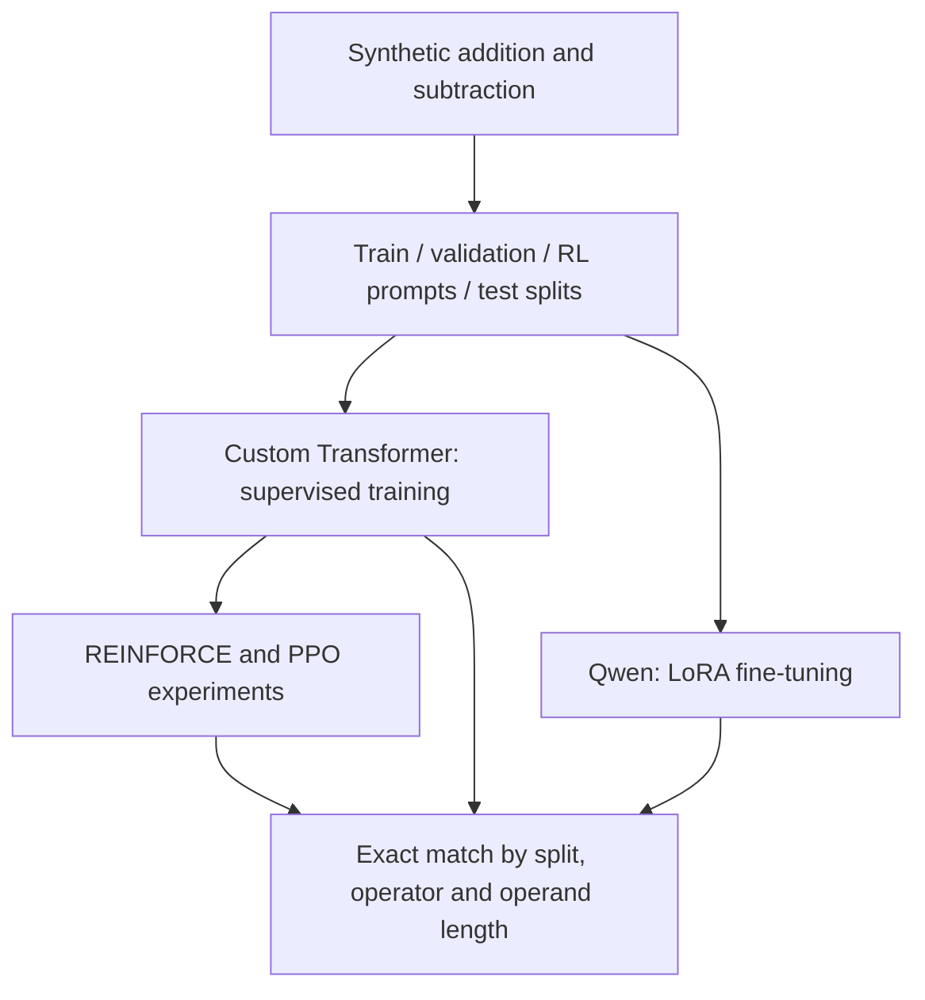

# Arithmetic reasoning with Transformers and reinforcement learning

An experimental notebook comparing a **character-level Transformer trained from scratch**, **Qwen2.5-0.5B-Instruct with LoRA**, and **REINFORCE/PPO policy-training experiments** on synthetic addition and subtraction.

The question is whether a model learns arithmetic that survives changes in numbers and prompt formatting, rather than only performing well on familiar examples.

## Inspect a result first

Saved outputs in the [notebook](arithmetic-reasoning-transformers.ipynb) show the following Qwen LoRA evaluation snapshot:

| Split | Exact-match accuracy | Evaluation limit |
| --- | --- | --- |
| Validation | 96.4% | Up to 500 examples |
| Seen test | 97.5% | Up to 1,000 examples |
| Unseen-number test | 97.2% | Up to 1,000 examples |
| Unseen-format test | 96.2% | Up to 1,000 examples |

Exact match means that the generated answer matches the expected answer under that evaluator's parsing rules. These are archived notebook outputs, not a newly reproduced result or evidence that Qwen outperforms the other models.

**Reproducibility note:** later checkpoint-reload cells give near-zero scores for Tiny Transformer models whose earlier evaluations were much higher. That inconsistency needs a clean rerun and checkpoint/tokenizer/evaluator checks before publishing a definitive cross-model or RL comparison. No claim of an RL improvement is made here.

## Experiment design

For prompts such as `103 - 88 =`, generate the answer autoregressively. The custom Transformer uses a character vocabulary; Qwen uses its pretrained tokenizer and chat formatting.



- **Supervised training:** a causal Transformer with positional encoding, attention, and prompt-masked answer loss.
- **Parameter-efficient adaptation:** Qwen LoRA adapters, with optional 4-bit quantisation.
- **Policy optimisation:** REINFORCE with a reward baseline and PPO experiments targeting arithmetic-answer rewards.
- **Generalisation tests:** held-out operand sets and prompt-format changes, reported separately from seen examples.

This is a controlled arithmetic study. It does not establish general mathematical reasoning or reliability on unrestricted language tasks.

## Run the notebook

```bash
git clone https://github.com/Mahmoud-AboShukr/arithmetic-reasoning-transformers.git
cd arithmetic-reasoning-transformers
python -m venv .venv
# Linux/macOS: source .venv/bin/activate
# Windows PowerShell: .venv\Scripts\Activate.ps1
python -m pip install -r requirements.txt
jupyter notebook arithmetic-reasoning-transformers.ipynb
```

Use a fresh kernel and follow the data-generation and model sections in order. Inspect local paths, device settings, and checkpoint selections before running. The pretrained-model and optional bitsandbytes quantisation stages require a compatible environment and access to Hugging Face model files; CUDA is recommended for training.

The notebook contains several experimental branches and saved execution states. It is a research notebook, not an unattended end-to-end training script. Before comparing runs, keep the data split, model configuration, tokenizer, decoding rules, and checkpoint identity fixed.

## Included and generated files

| Included in Git | Generated locally |
| --- | --- |
| Notebook, requirements, and README | CSV datasets, checkpoints, evaluation CSVs, and final-artifact exports |

Directories such as `data_task1/`, `checkpoints/`, `checkpoints_qwen_lora/`, `checkpoints_rl/`, and `results/` are local outputs, not pretrained assets supplied in this checkout.

## Reproduce an evaluation carefully

1. Generate and retain the split files and seeds.
2. Train or load the matching model with its original vocabulary/tokenizer.
3. Evaluate exact match separately for seen examples, unseen numbers, and unseen formats.
4. Record sample counts, parsing rules, checkpoint path, and dependency versions.
5. Resolve the saved-output inconsistency above before treating the notebook as a verified benchmark.
